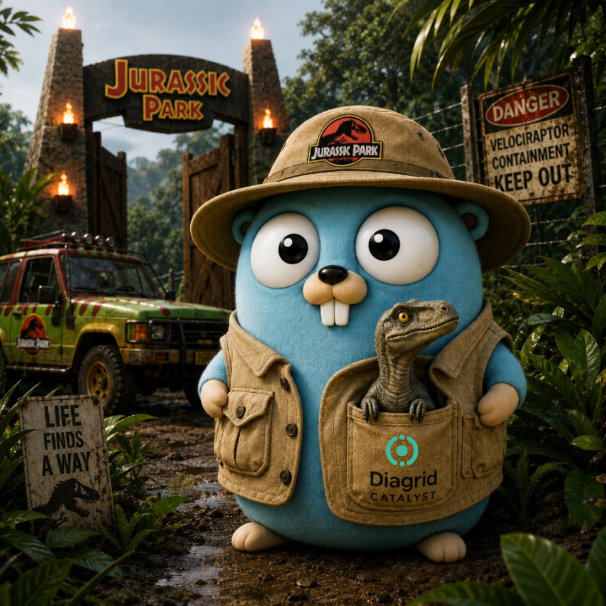

<p align="center">
  
</p>

# 🦖 GopherCon 2026 CTF — Jurassic Park on Diagrid Catalyst

Welcome! Bring Jurassic Park back online by building **durable AI agents in Go**
that run on [Diagrid Catalyst](https://www.diagrid.io/catalyst). In each
challenge your agent talks to the park's control systems and returns a **flag**
(`gc26{...}`) — submit it to score, then use it as the key to the next challenge.

## Before you start

- A [Catalyst account + the `diagrid` CLI](https://docs.diagrid.io/catalyst/references/cli-reference/), and Go 1.26.4+.
  - **Team size:** the Catalyst free tier allows **5 users per organization**. If your team has
    more than 5 people, split into multiple organizations (each with its own project) so
    everyone stays on the free tier.
- A model for the AI challenges (1 and 3) — **either one works**:
  - **[Ollama](https://ollama.com/download) — the default, and free.** The model runs on your own
    machine: no API key, no spend.
    ```bash
    ollama serve             # leave this running in its own terminal
    ollama pull qwen2.5:7b   # ~4.7 GB, the default model
    ```
  - **OpenAI** — already have a key? `export OPENAI_API_KEY=sk-...` and the agents pick it up
    automatically. `OPENAI_MODEL` defaults to `gpt-4o`. This bills your own account.

  Set `MODEL_PROVIDER=ollama` to stay on the free local model even with a key in your
  environment, or `MODEL_PROVIDER=openai` to force the hosted one. Each agent prints which
  model it's using at startup, so you're never guessing.

  Whichever you pick, the model **must support tool calling** (`qwen2.5`, `qwen3`, `llama3.1`,
  `gpt-4o`, …) — the challenges are won by calling tools, and a model without tool support will
  never reach a flag.
- Your **entry ticket** and the **park-systems connection details** — from the event brief.
- The challenges build on the public [go-ai](https://github.com/diagridio/go-ai) framework — a normal `go build` / `go run` fetches it automatically.
- One-time Catalyst setup:
  ```bash
  diagrid login
  diagrid project update <your-project> --enable-agent-infrastructure
  ```

## The challenges

Start at #1 and follow the flags — each flag you earn is the access code for the next.

| # | Challenge | Category | Difficulty | Points | You'll learn |
|---|---|---|---|---|---|
| 1 | [Welcome to Jurassic Park](challenges/ctf01-welcome/README.md) 🦕 | Catalyst | Easy | 50 | run your first agent, see it in Catalyst |
| 2 | [Hold Onto Your Butts](challenges/ctf02-durable/README.md) 🔌 | Catalyst | Medium | 75 | crash a durable workflow and watch it resume |
| 3 | [Access the Security Grid](challenges/ctf03-mcp/README.md) 🔐 | Catalyst | Medium | 75 | register an MCP server and call its tools |
| 4 | [Life Finds a Way](challenges/ctf04-capstone/README.md) 🦖 | Catalyst | Hard | 100 | run several agents together |

## The park control system (park-systems)

Your agents fetch their flags from **park-systems**, our hosted MCP "park control
system," running on the event VM. You don't run it — the organizers give you two
values before you start:

| Value | What it is | Where it goes |
|---|---|---|
| `<PARK_URL>` | the Streamable HTTP MCP endpoint, e.g. `https://park.<domain>/mcp` | `--url` |
| `<PARK_TOKEN>` | the shared **bearer token** that authenticates every request | `--header "Authorization=Bearer <PARK_TOKEN>"` |

Every challenge registers park-systems the same way. The token travels in an
`Authorization: Bearer` header on the MCPServer resource — it never goes in your
agent code:

```bash
diagrid mcpserver create park-systems --project $PROJECT \
  --url <PARK_URL> --transport streamable-http --scope <your-agent> \
  --header "Authorization=Bearer <PARK_TOKEN>"
```

Miss the header, or get the token wrong, and every call comes back **401
Unauthorized** — no tools, no flags. If tool discovery returns 0 tools, check
this first (`diagrid mcpserver get park-systems --project $PROJECT`).

The park-systems **server source is committed to this repo only *after* the
challenge**, so the flag values and unlock logic aren't exposed ahead of time.

Hold onto your butts. 🦕
